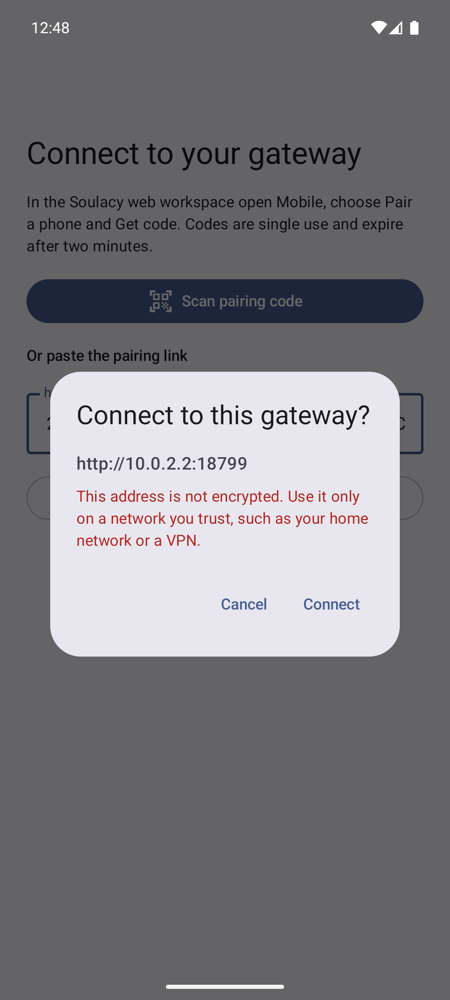
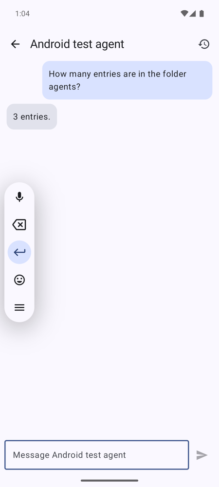
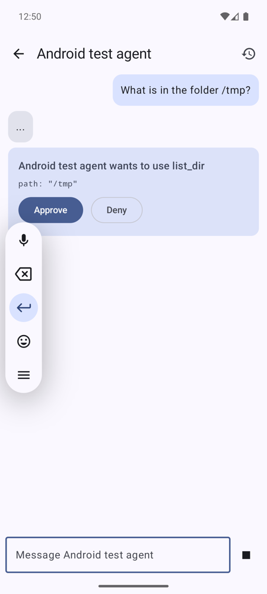
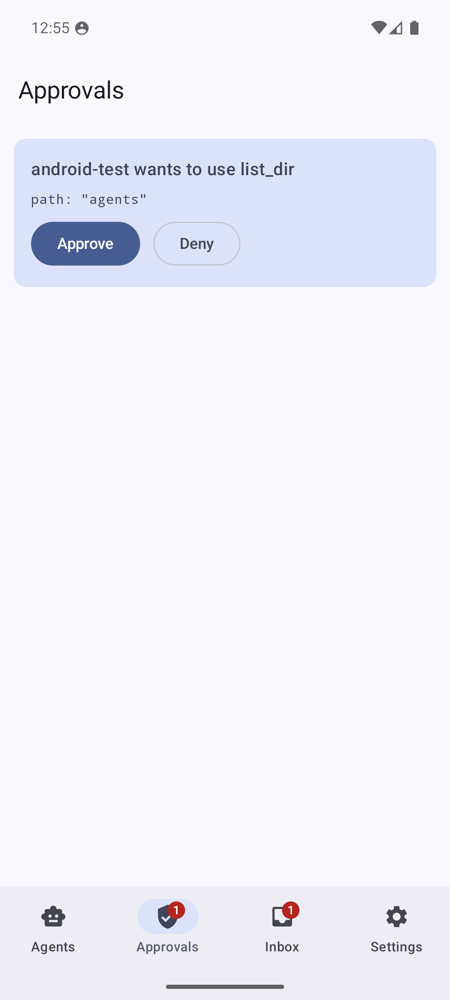
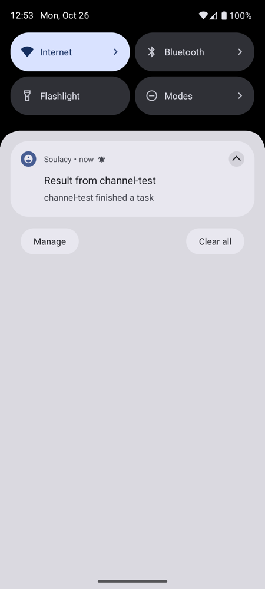
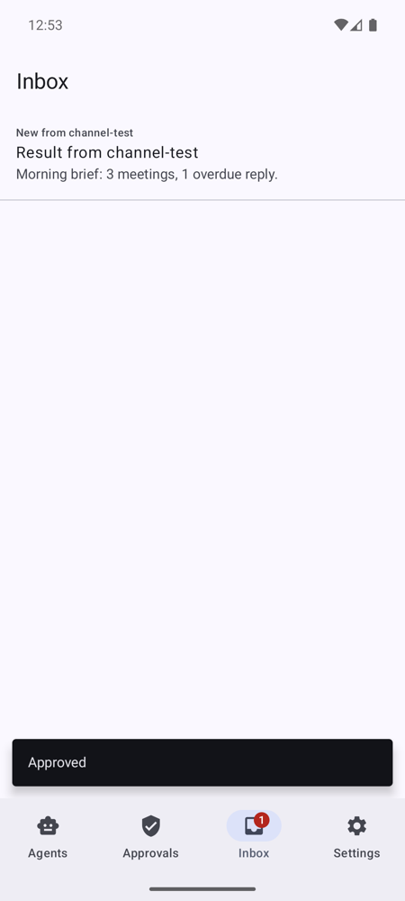

# Soulacy for Android

The Android companion for a self-hosted [Soulacy](https://soulacy.io) gateway, and the
counterpart of the iOS app. Your gateway runs the agents, holds their memory and enforces
every permission. The phone is where you talk to them, follow their results and decide
when an agent asks for approval.

| Pair | Chat | Approve in chat | Approvals | Notification | Inbox |
|---|---|---|---|---|---|
|  |  |  |  |  |  |

All screenshots come from the emulator run against a local gateway described under
[Verified end to end](#verified-end-to-end).

## What it does

- **QR pairing**, the same flow as iOS. It scans the gateway's single-use code (or takes the
  pasted link), redeems it for a scoped `mobile-companion` credential and registers this
  install for deliveries. It shows the address before connecting and warns about unencrypted
  `http://` addresses.
- **Agents and streaming chat.** It lists the gateway's chat agents and streams replies token
  by token over `POST /api/v1/chat/stream` (server-sent events). Stop cancels the run.
- **Approvals.**
  - When an agent hits a confirmation gate, the app shows it two ways: inline in the chat (the
    `tool_confirm` event) and in the Approvals tab, which lists every approval pending for you,
    including ones from runs you started elsewhere.
  - Approve and Deny first require the device lock (fingerprint, face or screen-lock PIN), like
    Face ID on iOS. A phone with no screen lock cannot approve.
  - Website purchase approvals (`commit_website_action`) show their full arguments for review.
- **Notifications.**
  - Approvals arrive on a high-priority channel. Results from scheduled and long-running agents
    arrive on a default channel, and the Inbox holds them.
  - Notification text is generic (agent and tool names only), and tapping one opens the right
    tab. The content is always fetched from the gateway.
- **Safe Undo receipts, read-only.** Each agent's receipts list is one tap from the chat.
  Preview, apply and undo stay on the web: they need `agents:write`, which the phone credential
  does not have.
- **Unpair** in Settings revokes this phone's credential on the gateway.

## Privacy and security

- The app talks **only to your paired gateway**. There is no analytics, crash reporting or
  tracking SDK. QR decoding uses ZXing on the device, not Google ML Kit.
- **The credential is sealed with AES-256-GCM** under a non-exportable Android Keystore key.
  It is excluded from backup and device transfer. Uninstalling or clearing data destroys the
  key.
- **TLS pinning works like iOS.** When the QR carries `fp=`, the app trusts exactly that key.
  The fingerprint is the gateway's raw-public-key SHA-256 (`publicKeyFingerprint` in
  `internal/gateway/autotls.go`), not an SPKI pin. Unit tests compare the app's computation
  against vectors produced by the gateway's own Go code. Without a pin, normal system trust
  applies, including user-installed CAs for gateways behind a private CA.
- Requests never follow redirects, so the credential cannot be forwarded to another host.
- **Push is optional.** It uses Firebase Cloud Messaging only when the build is given a Firebase
  project (see [Push notifications](#push-notifications)). The default build never initialises
  Firebase.

## Requirements

- Android 8.0 (API 26) or newer.
- A Soulacy gateway the phone can reach: on the same network, over a VPN or tailnet, or at a
  public HTTPS address. `localhost` on the phone means the phone.
- Android push needs the gateway change in
  [vmodekurti/soulacy-personal#385](https://github.com/vmodekurti/soulacy-personal/pull/385).
  Without it, everything else works and the app falls back to polling.

## Pairing

1. In the Soulacy web workspace open **Mobile → Pair a phone → Get code**.
2. In the app choose **Scan pairing code** and scan the QR. Or copy the pairing link
   (`http(s)://<gateway>/mobile?pair=<CODE>`) and paste it.
3. Check the address and choose **Connect**.

Codes are single use and expire after two minutes. The gateway allows one paired phone per
person, so unpair the old one first (in the app, or on the web Mobile page).

## Build

You need JDK 21 and the Android SDK (platform 37, build tools 36+). Then:

```bash
./gradlew :app:testDebugUnitTest      # unit tests (API, SSE parser, pairing, pinning, secrets, sync)
./gradlew :app:assembleDebug          # app/build/outputs/apk/debug/app-debug.apk
./gradlew :app:assembleRelease        # minified; signed only when the signing env vars are set
```

`local.properties` (not committed) must point `sdk.dir` at your SDK.

## Push notifications

The gateway sends a data-only FCM message that carries no content. The app treats it as a
wake-up and fetches the approval or result from the gateway, which is how iOS uses APNs. To
enable it:

1. Create a Firebase project and add an Android app with package `dev.soulacy.android`.
2. Build with its public client identifiers. They are not secrets, but are kept out of the repo
   so each operator uses their own project:

   ```bash
   ./gradlew :app:assembleRelease \
     -Psoulacy.fcm.projectId=... -Psoulacy.fcm.applicationId=1:...:android:... \
     -Psoulacy.fcm.apiKey=... -Psoulacy.fcm.senderId=...
   ```

   CI reads the same values from the `SOULACY_FCM_*` repository variables.
3. On the gateway, set `SOULACY_MOBILE_FCM_CREDENTIALS_FILE` to that project's service-account
   JSON (see `docs/channels/mobile.md` in soulacy-personal).

FCM routes the wake-up through Google. If that is not acceptable, use the default build: it
checks the gateway every 15 minutes in the background and every few seconds while open.

## Releasing

`.github/workflows/release.yml` runs on a `v*` tag. It builds a signed APK, prints the signing
certificate and attaches the APK and its `.sha256` to a **draft** GitHub Release. The draft
is published by hand.

The signing key is yours to create and keep. Never commit it. Generate it once on your own
machine and store it only as repository secrets:

| Secret | Value |
|---|---|
| `SOULACY_KEYSTORE_BASE64` | `base64 < release.jks` |
| `SOULACY_KEYSTORE_PASSWORD` | keystore password |
| `SOULACY_KEY_ALIAS` | key alias |
| `SOULACY_KEY_PASSWORD` | key password |

Keep an offline backup of the keystore. Android only installs updates signed with the same key.

## Verified end to end

Run on the API 36 emulator against a local gateway built from soulacy-personal#385, with a
throwaway workspace and a test agent (`glm-4.7-flash` on Ollama) whose `list_dir` tool needs
confirmation:

- **Pair:** pasted link, address check, redeem (200), device registration (201). The gateway
  then listed the phone as paired.
- **Credential storage:** the paired credential survived an app reinstall (Keystore-sealed).
- **Chat:** the reply streamed in, and Stop and Back work.
- **Approve in chat:** the inline card, then the device-lock PIN, then `POST /approvals/:id/approve`
  (200). The tool ran and the agent answered "3 entries", which matched the folder.
- **Deny from the Approvals tab:** the approval was pending with a badge and a notification; the
  PIN prompt passed, deny returned 200, and the notification was withdrawn.
- **Result notification:** a delivery through the gateway's mobile channel test produced a
  notification. Tapping it opened the Inbox with the content.
- **Unpair:** returned 200, after which the gateway reported `paired: false`.

## Not done yet

- **FCM push has not been tested on a device.** It needs a Firebase project. The gateway side
  has unit tests against a fake FCM server in #385, and the polling fallback is what the emulator
  run used.
- **QR scanning by camera** is implemented (CameraX + ZXing) but was not exercised in the
  emulator. Pairing was verified through the pasted-link path, which uses the same parser.
- **Safe Undo on the phone is read-only.** Preview, apply and undo need a credential with
  `agents:write`.
- **Not ported from iOS:**
  - device commands for agents (location, calendar, health and so on: the `/mobile/nodes`
    gateway API accepts only iOS and watchOS nodes today)
  - location triggers, widgets, a Live Activities equivalent, voice and Android Auto
  - share-sheet capture, adaptive memory, the person model
  - household profile switching and multiple gateways
- **No notification actions.** Approvals always open the app, so the decision passes the device
  lock in the app.
- **No instrumented UI tests yet.** Unit tests cover the API, pairing, pinning, secret sealing
  and sync layers.
- **No public download yet.** The APK is not published anywhere. Public download needs a public
  host: this repository is private, so a release asset here is not downloadable from
  soulacy.io.
