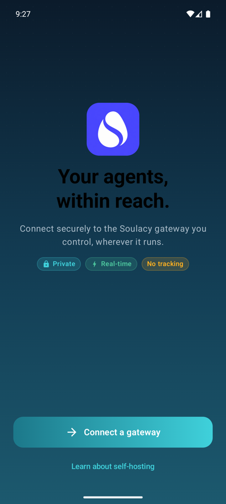
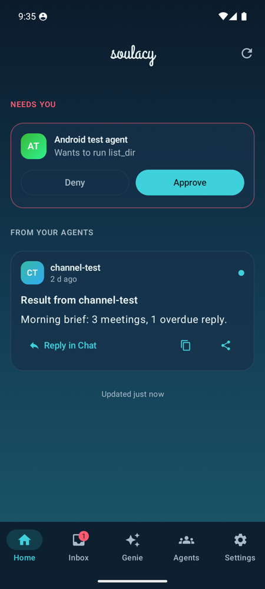
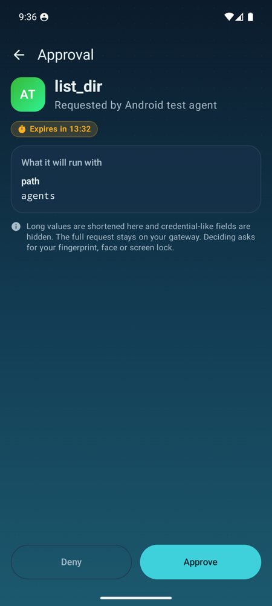
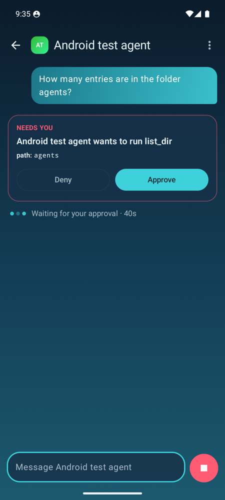
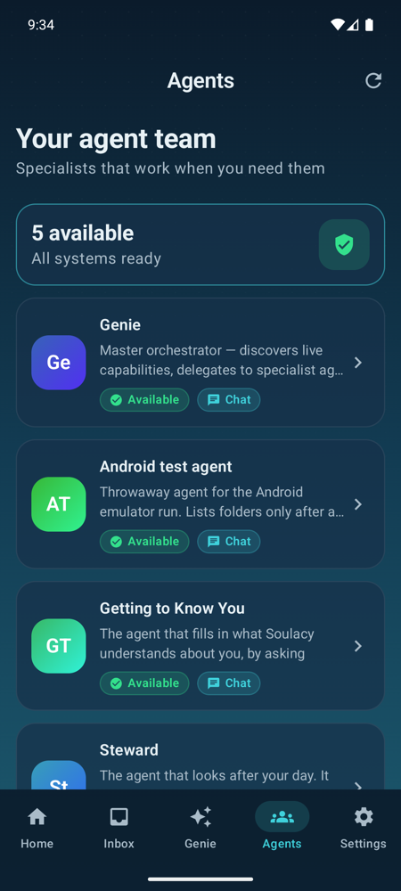
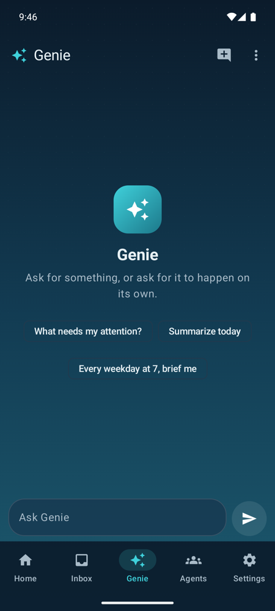

# Soulacy for Android

The Android companion for a self-hosted [Soulacy](https://soulacy.io) gateway, and the
counterpart of the iOS app. Your gateway runs the agents, holds their memory and enforces
every permission. The phone is where you talk to them, follow their results and decide
when an agent asks for approval.

| Welcome | Home | Inbox | Approval | Chat | Agents | Genie |
|---|---|---|---|---|---|---|
|  |  |  |  |  |  |  |

All screenshots come from the emulator run against a local gateway described under
[Verified end to end](#verified-end-to-end). More are in `docs/screenshots/`, including
light mode.

## What it does

The layout, look and wording follow the iOS app: the same tabs, onboarding steps and palette
(sea accent on a navy-to-teal field), and the same per-agent avatar colours.

- **Onboarding**, step for step like iOS:
  - a welcome screen, then **connect** (scan the QR, or paste the pairing link) and a check
    of the gateway address, with a warning for unencrypted `http://`
  - **verifying**, where failures are named: unknown host, timeout, nothing listening,
    certificate or pin mismatch, expired code, phone already paired
  - **where the gateway is reachable from** (home network, VPN or tunnel, anywhere). Later
    connection errors use that answer ("is this phone on your home network?").
  - **notifications**, with the reason shown before Android asks
  - landing on the Inbox
- **Five tabs: Home, Inbox, Genie, Agents, Settings.**
  - **Home** is the feed. Approvals waiting for you sit on top as "Needs you" cards. Results
    from agents follow as cards with formatted text, Reply in Chat, Copy and Share.
  - **Inbox** holds decisions with deadlines, grouped as "Expiring soon" (under 3 minutes)
    and "Waiting on you", each with a live countdown. Swipe to deny; tap for the detail view.
    The tab badge counts pending approvals only.
  - **Genie** is a conversation with the gateway's `genie` agent, with the iOS suggestions on
    an empty conversation.
  - **Agents** ("Your agent team") shows a status summary, a card per agent and recent
    conversations.
  - **Settings** shows the gateway, connection state, reachability, notifications, privacy and
    unpair.
- **Approval detail** shows what is asked, by which agent and why, and the countdown. The
  arguments are readable:
  - lists lead with their size ("14 items"), because the count is the blast radius
  - long values are shortened
  - credential-shaped keys are hidden
  - Deny is on the left and Approve on the right. Every decision passes the device lock
    (fingerprint, face or screen-lock PIN), like Face ID on iOS. A phone with no screen lock
    cannot approve.
- **Chat:**
  - replies stream in token by token over `POST /api/v1/chat/stream`, with Markdown (headings,
    lists, code, quotes, links)
  - a working line ("Thinking", "Waiting for your approval", "Running list_dir") with elapsed
    time
  - the approval card inline, long-press to copy or share, and Stop
  - a reply keeps arriving after you leave the conversation
  - conversations are kept on the phone only, so you can come back to them
- **Offline first.** Lists render from the last good copy with an "Updated 4 min ago" footer.
  The connection shows as a thin line under the title bar, never a dialog.
- **Notifications** use a high-priority channel for approvals and a default one for results.
  The text is generic (agent and tool names); tapping opens the approval or the feed. The
  content is always fetched from the gateway.
- **Safe Undo receipts, read-only**, from a chat's menu. Preview, apply and undo stay on the
  web: they need `agents:write`, which the phone credential does not have.

## Privacy and security

- The app talks **only to your paired gateway**. There is no analytics, crash reporting or
  tracking SDK. QR decoding uses ZXing on the device, not Google ML Kit.
- **The credential is sealed with AES-256-GCM** under a non-exportable Android Keystore key.
  It is excluded from backup and device transfer. Uninstalling or clearing data destroys the
  key.
- **TLS pinning works like iOS.** When the QR carries `fp=`, the app trusts exactly that key.
  The fingerprint is the gateway's raw-public-key SHA-256 (`publicKeyFingerprint` in
  `internal/gateway/autotls.go`), not an SPKI pin. Unit tests compare the app's computation
  against vectors produced by the gateway's own Go code. Without a pin, normal system trust
  applies, including user-installed CAs for gateways behind a private CA.
- Requests never follow redirects, so the credential cannot be forwarded to another host.
- **Push is optional.** It uses Firebase Cloud Messaging only when the build is given a Firebase
  project (see [Push notifications](#push-notifications)). The default build never initialises
  Firebase.

## Requirements

- Android 8.0 (API 26) or newer.
- A Soulacy gateway the phone can reach: on the same network, over a VPN or tailnet, or at a
  public HTTPS address. `localhost` on the phone means the phone.
- Android push needs the gateway change in
  [vmodekurti/soulacy-personal#385](https://github.com/vmodekurti/soulacy-personal/pull/385).
  Without it, everything else works and the app falls back to polling.

## Pairing

1. In the Soulacy web workspace open **Mobile → Pair a phone → Get code**.
2. In the app choose **Scan pairing code** and scan the QR. Or copy the pairing link
   (`http(s)://<gateway>/mobile?pair=<CODE>`) and paste it.
3. Check the address and choose **Connect**.

Codes are single use and expire after two minutes. The gateway allows one paired phone per
person, so unpair the old one first (in the app, or on the web Mobile page).

## Build

You need JDK 21 and the Android SDK (platform 37, build tools 36+). Then:

```bash
./gradlew :app:testDebugUnitTest      # unit tests (API, SSE parser, pairing, pinning, secrets, sync)
./gradlew :app:assembleDebug          # app/build/outputs/apk/debug/app-debug.apk
./gradlew :app:assembleRelease        # minified; signed only when the signing env vars are set
```

`local.properties` (not committed) must point `sdk.dir` at your SDK.

## Push notifications

The gateway sends a data-only FCM message that carries no content. The app treats it as a
wake-up and fetches the approval or result from the gateway, which is how iOS uses APNs. To
enable it:

1. Create a Firebase project and add an Android app with package `dev.soulacy.android`.
2. Build with its public client identifiers. They are not secrets, but are kept out of the repo
   so each operator uses their own project:

   ```bash
   ./gradlew :app:assembleRelease \
     -Psoulacy.fcm.projectId=... -Psoulacy.fcm.applicationId=1:...:android:... \
     -Psoulacy.fcm.apiKey=... -Psoulacy.fcm.senderId=...
   ```

   CI reads the same values from the `SOULACY_FCM_*` repository variables.
3. On the gateway, set `SOULACY_MOBILE_FCM_CREDENTIALS_FILE` to that project's service-account
   JSON (see `docs/channels/mobile.md` in soulacy-personal).

FCM routes the wake-up through Google. If that is not acceptable, use the default build: it
checks the gateway every 15 minutes in the background and every few seconds while open.

## Releasing

`.github/workflows/release.yml` runs on a `v*` tag. It builds a signed APK, prints the signing
certificate and attaches `soulacy-android.apk` and `soulacy-android.apk.sha256` to a **draft**
GitHub Release. The draft is published by hand. The asset names never change, so
`https://github.com/vmodekurti/soulacy-android/releases/latest/download/soulacy-android.apk`
(linked from soulacy.io as `soulacy.io/android.apk`) always serves the newest published release.

Create the keystore once, on your own machine:

```bash
keytool -genkeypair -v -keystore soulacy-release.jks -alias soulacy -keyalg RSA -keysize 4096 -validity 10000
```

The signing key is yours to create and keep. Never commit it. Generate it once on your own
machine and store it only as repository secrets:

| Secret | Value |
|---|---|
| `SOULACY_KEYSTORE_BASE64` | `base64 < soulacy-release.jks` |
| `SOULACY_KEYSTORE_PASSWORD` | keystore password |
| `SOULACY_KEY_ALIAS` | key alias (`soulacy` above) |
| `SOULACY_KEY_PASSWORD` | key password |

Keep an offline backup of the keystore. Android only installs updates signed with the same key.

## Verified end to end

Run on the API 36 emulator, in dark and light mode, against a local gateway built from
soulacy-personal#385. It used a throwaway workspace and a test agent (`glm-4.7-flash` on
Ollama) whose `list_dir` tool needs confirmation.

- **Onboarding from a clean install:** welcome, paste link, address check, verify (redeem 200,
  device registration 201), reachability, the notification reason screen and then Android's
  permission prompt, "You're connected", landing on the Inbox.
- **Chat:** the "Waiting for your approval" line and the inline approval card appeared. The
  conversation was left while it waited.
- **The same approval elsewhere:** it appeared as a "Needs you" card on Home and in the Inbox
  with a countdown and badge.
- **Approve:** from the detail view, then the device-lock PIN, then
  `POST /approvals/:id/approve` (200). The reply ("There are 3 entries in the agents folder.",
  correct) arrived while the conversation was closed and is in its history.
- **Markdown:** a result with a heading, bold and italic text, a list, inline code, a quote, a
  code block and a link rendered on Home.
- **Genie:** the empty state and a suggestion sent a message. The test model refused Genie's
  full prompt (over its 16K-token budget), and the app showed that as a plain sentence with
  the gateway's detail.
- **Earlier MVP run:** deny from the Inbox, the notification deep link to the Inbox,
  unpair, and the credential surviving a reinstall.

## Not done yet

- **FCM push has not been tested on a device.** It needs a Firebase project. The gateway side
  has unit tests against a fake FCM server in #385, and the polling fallback is what the emulator
  run used.
- **QR scanning by camera** is implemented (CameraX + ZXing) but was not exercised in the
  emulator. Pairing was verified through the pasted-link path, which uses the same parser.
- **Safe Undo on the phone is read-only.** Preview, apply and undo need a credential with
  `agents:write`.
- **Not ported from iOS:**
  - device commands for agents (location, calendar, health and so on: the `/mobile/nodes`
    gateway API accepts only iOS and watchOS nodes today)
  - location triggers, widgets, a Live Activities equivalent, voice and Android Auto
  - share-sheet capture, adaptive memory, the person model
  - household profile switching and multiple gateways
- **No notification actions.** Approvals always open the app, so the decision passes the device
  lock in the app.
- **No instrumented UI tests yet.** Unit tests cover the API, pairing, pinning, secret sealing,
  sync, Markdown, approval timing and arguments, conversation storage and error wording.
- **iOS screens not ported yet:**
  - Activity (runs and schedules)
  - Board (workboard)
  - the story rail and archive on Home
  - attachments and voice in chat
  - multiple gateway profiles
- **Building inside an iCloud-synced folder** (such as Documents with iCloud Desktop and
  Documents on) can fail with "is defined multiple times". iCloud copies build files as
  `name 2.dex`. Run `./gradlew clean`, or keep the checkout outside iCloud.
